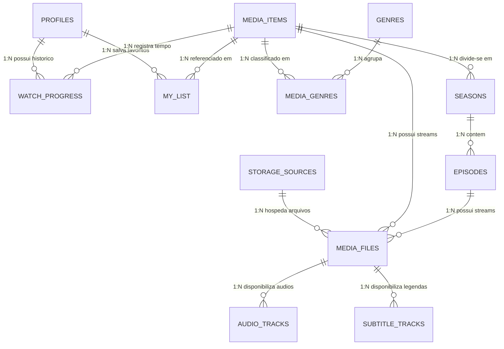

# 🎬 MinattoFlix V2 — Documento de Engenharia de Software (ERS, MER e Arquitetura)

**Projeto:** MinattoFlix V2 — Plataforma Pessoal de Streaming VOD Multi-Cloud (Estilo Netflix)  
**Infraestrutura:** Cloudflare Workers (Paid Plan) + Neon Serverless PostgreSQL (`aws-sa-east-1`) + Google Drive & Microsoft OneDrive  
**Domínio:** Subdomínio nativo Cloudflare (`*.workers.dev`)

---

## 1. Visão Geral do Sistema

O **MinattoFlix V2** é uma plataforma de vídeo sob demanda (VOD) pessoal projetada com a identidade visual e experiência de uso idênticas à **Netflix**, utilizando como armazenamento primário pastas pessoais/compartilhadas do **Google Drive** e **Microsoft OneDrive**.

O sistema elimina a necessidade de servidores VPS caros ou armazenamento pago em S3 ao empregar um **Cloudflare Worker (Plano Pago)** na borda (Edge) que atua simultaneamente como:
1. **Servidor da Aplicação Web (SPA React 19)**;
2. **API REST Serverless conectada ao banco Neon PostgreSQL (`minattoflix`)**;
3. **Indexador Inteligente Multi-Cloud** (Google Drive + OneDrive + Enriquecimento de Metadados TMDB/IMDb);
4. **Proxy de Streaming Binário HTTP 206 (`Partial Content` / Range Requests)** com inspeção de cabeçalhos Matroska (`.mkv`) via EBML e suporte nativo a **Dual Áudio** (faixas embutidas no mesmo `.mkv`/`.mp4` ou arquivos separados) e **Legendas** (embutidas ou arquivos `.srt`/`.vtt`/`.ass` externos).

---

## 2. Levantamento de Requisitos

### 2.1. Requisitos Funcionais (RF)

| ID | Nome do Requisito | Prioridade | Especificação |
| :--- | :--- | :---: | :--- |
| **RF-01** | Gestão e Seleção de Perfis ("Quem está assistindo?") | Alta | O sistema deve permitir selecionar e criar perfis independentes (ex.: *Rafael*, *Família*, *Kids*), armazenando preferências de idioma de áudio, idioma de legenda e restrição de classificação indicativa infantil. |
| **RF-02** | Indexação Automática de Pastas do Google Drive | Alta | O sistema deve varrer pastas compartilhadas ou autenticadas do Google Drive (como `12ttfjMP_2MCPvOLiy8bei0oFLa-8UBT3`), descobrindo subpastas de filmes/séries e arquivos de vídeo (`.mkv`, `.mp4`, `.webm`), áudio externo (`.mka`, `.aac`, `.mp3`, `.ac3`) e legendas (`.srt`, `.vtt`, `.ass`), filtrando arquivos promocionais (`.url`, `.txt`). |
| **RF-03** | Indexação Automática de Pastas do Microsoft OneDrive | Alta | O sistema deve resolver links compartilhados `1drv.ms` e pastas do OneDrive via Microsoft Share API / Graph API, catalogando arquivos de mídia e permitindo espelhamento (mirror) ou soma de catálogos com o Google Drive. |
| **RF-04** | Parser de Nomes de Release (Scene/P2P) | Alta | O sistema deve interpretar nomes padronizados de releases (ex.: `Minions & Monstros 2026 WEB-DL 2160p x265 HDR10+ DUAL 5.1.mkv`) para extrair automaticamente: Título limpo, Ano, Resolução (`2160p`/`4K`, `1080p`), Alcance Dinâmico (`HDR10+`, `DV`, `SDR`), Codec (`x265`, `x264`), Canais (`5.1`, `2.0`) e indicador `DUAL`. |
| **RF-05** | Enriquecimento Automático de Metadados | Alta | O sistema deve buscar automaticamente pôsteres oficiais em alta resolução, imagens de fundo (backdrop 16:9), sinopse em português, nota de avaliação, classificação etária, duração, gêneros, elenco e chave de trailer. |
| **RF-06** | Catálogo Principal Idêntico à Netflix | Alta | A tela inicial deve apresentar Navbar translúcida com transição em scroll, *Hero Billboard* em tela cheia com trailer/backdrop, botões *Assistir* e *Mais Informações*, e carrosséis horizontais (*Continuar Assistindo*, *Adicionados Recentemente*, *Em 4K HDR10+*, *Universo DC & Heróis*, *Animação & Família*, *Minha Lista*). |
| **RF-07** | Streaming via Proxy Edge com HTTP Range (`206 Partial Content`) | Crítica | O Worker deve intermediar a leitura dos arquivos do Google Drive e OneDrive repassando o cabeçalho `Range: bytes=start-end`, permitindo avanço imediato (*seek*) em arquivos grandes (2 GB a 16 GB+) sem download prévio e sem retenção em memória RAM. |
| **RF-08** | Dual Áudio — Modo A: Faixas Embutidas no Mesmo Arquivo (`.mkv` / `.mp4`) | Crítica | O sistema deve inspecionar o cabeçalho EBML/MP4 do arquivo para listar todas as faixas de áudio embutidas (ex.: *Faixa 1: Português 5.1 Dublado*, *Faixa 2: Inglês 5.1 Original*) e permitir a troca em tempo real pelo menu do player via `audioTracks` nativo, stream demuxer (`Mediabunny`/WebAudio) ou remuxing. |
| **RF-09** | Dual Áudio — Modo B: Arquivos Separados de Áudio ou Vídeo | Crítica | O sistema deve permitir associar ao mesmo filme arquivos de áudio separados (`.mka`, `.aac`, `.mp3`) sincronizados dinamicamente com o `currentTime` do vídeo principal, ou alternar entre arquivos de vídeo distintos (*Vídeo Dublado* vs *Vídeo Legendado*) mantendo a posição exata de reprodução. |
| **RF-10** | Suporte Completo a Legendas (Embutidas, Externas e Upload Local) | Crítica | O player deve suportar legendas embutidas no `.mkv`, arquivos `.srt`/`.vtt`/`.ass` salvos na pasta da nuvem (convertendo `.srt` e `.ass` para WebVTT UTF-8 automaticamente na Edge), além de permitir carregar um arquivo `.srt`/`.vtt` local do computador/celular e ajustar sincronia (`±0.5s`) e tamanho da fonte. |
| **RF-11** | Player Customizado Netflix UI | Alta | Controles visuais fiéis à Netflix com barra de progresso vermelha (`#E50914`), botões de `-10s` e `+10s`, controle de volume, velocidade (`0.5x` a `2.0x`), popover de duas colunas (**Áudio** | **Legendas**), seletor de nuvem (Google Drive / OneDrive), Picture-in-Picture e Tela Cheia. |
| **RF-12** | Persistência de "Continuar Assistindo" por Perfil | Alta | O progresso de reprodução (`position_seconds`, `duration_seconds`, faixa de áudio e legenda escolhidas) deve ser salvo automaticamente no Neon PostgreSQL e exibido com barra de progresso vermelha na fileira *Continuar Assistindo*. |
| **RF-13** | Gestão de "Minha Lista" | Média | Cada perfil pode adicionar ou remover títulos da sua lista pessoal de favoritos (*Minha Lista*). |
| **RF-14** | Suporte a Séries, Temporadas e Episódios | Média | Estrutura hierárquica para séries com seletor de temporada, lista de episódios com miniatura/duração e botão *Próximo Episódio*. |
| **RF-15** | Busca Instantânea e Filtros de Catálogo | Média | Pesquisa em tempo real por título, título original, elenco, gênero ou qualidade (`4K`, `HDR10+`, `Dual`). |
| **RF-16** | Painel "Minatto Cloud Studio" (Gerenciador de Nuvem e Mídia) | Alta | Modal administrativo para cadastrar novas pastas do Google Drive e OneDrive, executar sincronização sob demanda, inspecionar os arquivos `.mkv` detectados e vincular faixas externas de áudio/legenda. |

---

### 2.2. Requisitos Não-Funcionais (RNF)

| ID | Categoria | Especificação Técnica |
| :--- | :--- | :--- |
| **RNF-01** | **Infraestrutura & Domínio** | Hospedado integralmente no Cloudflare Workers (`.workers.dev`), sem necessidade de registro de domínio pago. |
| **RNF-02** | **Eficiência de Memória** | Streaming via `ReadableStream` nativo em *pass-through* (zero buffering em memória), suportando arquivos de 16 GB+ dentro do limite de 128 MB de RAM do Worker. |
| **RNF-03** | **Banco de Dados Serverless** | PostgreSQL 17 no **Neon** (região `aws-sa-east-1` — São Paulo), em database isolado `minattoflix` dentro do projeto `minatto` (`purple-union-72678311`). |
| **RNF-04** | **Baixa Latência de Seek** | Respostas HTTP `206 Partial Content` com `Accept-Ranges: bytes` e cache de metadados de sessão de download do Google Drive/OneDrive. |
| **RNF-05** | **Design System Netflix** | Cores `#141414` (background), `#181818` (modais), `#E50914` (vermelho primário), `#46D369` (verde de relevância "98% relevante") e tipografia condensada de alto impacto no logo e banners. |
| **RNF-06** | **Segurança e CORS** | Cabeçalhos CORS e `Cross-Origin-Resource-Policy` configurados no proxy para permitir inspeção binária de cabeçalhos MKV pelo navegador sem bloqueios de origem cruzada. |

---

## 3. Modelo Entidade-Relacionamento (MER)

### 3.1. Diagrama Entidade-Relacionamento

### 3.2. Matriz de Relacionamento de Entidades e Regras de Integridade

| Entidade Origem | Cardinalidade | Entidade Destino | Regra de Negócio e Integridade Referencial |
| :--- | :---: | :--- | :--- |
| `PROFILES` | `1 : N` | `WATCH_PROGRESS` | `ON DELETE CASCADE`. Cada perfil mantém seu próprio segundo exato de parada (`position_seconds`) por título (`UNIQUE(profile_id, media_item_id)`). |
| `PROFILES` | `1 : N` | `MY_LIST` | `ON DELETE CASCADE`. Cada perfil possui sua lista individual de filmes/séries favoritados (`UNIQUE(profile_id, media_item_id)`). |
| `STORAGE_SOURCES` | `1 : N` | `MEDIA_FILES` | `ON DELETE CASCADE`. Representa uma pasta raiz do Google Drive (`gdrive`) ou OneDrive (`onedrive`). Cada arquivo possui `UNIQUE(storage_source_id, external_file_id)`. |
| `MEDIA_ITEMS` | `N : M` | `GENRES` | Associados pela tabela associativa `MEDIA_GENRES` (`PK(media_item_id, genre_id)`). |
| `MEDIA_ITEMS` | `1 : N` | `MEDIA_FILES` | Permite que um mesmo filme tenha múltiplos arquivos: arquivo principal no Google Drive, mirror no OneDrive, ou arquivos separados para versão Dublada e versão Legendada. |
| `MEDIA_FILES` | `1 : N` | `AUDIO_TRACKS` | `ON DELETE CASCADE`. Cada registro representa uma opção de idioma no player, podendo ser `embedded` (faixa interna do `.mkv`), `external_file` (arquivo `.mka`/`.aac`/`.mp3` separado) ou `alternate_video` (outro vídeo sincronizado). |
| `MEDIA_FILES` | `1 : N` | `SUBTITLE_TRACKS` | `ON DELETE CASCADE`. Cada registro representa uma legenda selecionável no player, podendo ser `embedded` (extraída do `.mkv`) ou `external_file` (arquivo `.srt`/`.vtt`/`.ass` na nuvem ou enviado pelo usuário). |

---

## 4. Dicionário de Dados Completo (PostgreSQL 17 — Database `minattoflix`)

### 4.1. Tabela `profiles`
| Coluna | Tipo | Nulo | Padrão | Descrição |
| :--- | :--- | :---: | :--- | :--- |
| `id` | `UUID` | Não | `gen_random_uuid()` | Identificador único do perfil (PK) |
| `name` | `VARCHAR(100)` | Não | — | Nome exibido na tela "Quem está assistindo?" |
| `avatar_url` | `TEXT` | Não | — | URL do avatar do perfil |
| `is_kids` | `BOOLEAN` | Não | `false` | Se ativo, filtra apenas conteúdos com classificação `L` ou `10` |
| `preferred_audio_lang` | `VARCHAR(20)` | Não | `'pt-BR'` | Idioma de áudio selecionado automaticamente ao abrir o player |
| `preferred_subtitle_lang` | `VARCHAR(20)` | Não | `'off'` | Idioma de legenda padrão (`pt-BR`, `en-US`, `off`) |
| `pin_code` | `VARCHAR(10)` | Sim | `NULL` | PIN opcional de bloqueio de perfil |
| `created_at` | `TIMESTAMPTZ` | Não | `NOW()` | Data de criação |

### 4.2. Tabela `storage_sources`
| Coluna | Tipo | Nulo | Padrão | Descrição |
| :--- | :--- | :---: | :--- | :--- |
| `id` | `UUID` | Não | `gen_random_uuid()` | Identificador da fonte de nuvem (PK) |
| `name` | `VARCHAR(150)` | Não | — | Nome amigável (ex.: *Google Drive — Pasta Filmes*) |
| `provider` | `VARCHAR(30)` | Não | — | Provedor (`'gdrive'` ou `'onedrive'`) |
| `root_folder_id` | `VARCHAR(255)` | Não | — | ID da pasta no Google Drive ou Item ID no OneDrive |
| `share_url` | `TEXT` | Não | — | Link público original compartilhado pelo usuário |
| `auth_config` | `JSONB` | Sim | `'{}'` | Tokens OAuth / API Keys opcionais para pastas privadas |
| `is_active` | `BOOLEAN` | Não | `true` | Indica se a fonte está ativa para escaneamento e streaming |
| `last_synced_at` | `TIMESTAMPTZ` | Sim | `NULL` | Data/hora da última varredura bem-sucedida |

### 4.3. Tabela `media_items`
| Coluna | Tipo | Nulo | Padrão | Descrição |
| :--- | :--- | :---: | :--- | :--- |
| `id` | `UUID` | Não | `gen_random_uuid()` | Identificador do filme ou série (PK) |
| `type` | `VARCHAR(20)` | Não | `'movie'` | `'movie'` ou `'series'` |
| `title` | `VARCHAR(255)` | Não | — | Título em Português |
| `original_title` | `VARCHAR(255)` | Sim | `NULL` | Título original da obra |
| `slug` | `VARCHAR(255)` | Não | — | Identificador amigável único (`UNIQUE`) |
| `release_year` | `INTEGER` | Sim | `NULL` | Ano de lançamento |
| `overview` | `TEXT` | Sim | `NULL` | Sinopse completa exibida no Hero e no Modal |
| `tagline` | `VARCHAR(500)` | Sim | `NULL` | Frase de destaque |
| `poster_url` | `TEXT` | Sim | `NULL` | URL do pôster vertical |
| `backdrop_url` | `TEXT` | Sim | `NULL` | URL do backdrop 16:9 de alta definição |
| `logo_url` | `TEXT` | Sim | `NULL` | Logo transparente opcional |
| `trailer_youtube_key` | `VARCHAR(64)` | Sim | `NULL` | ID do vídeo de trailer no YouTube |
| `rating` | `NUMERIC(3,1)` | Sim | `8.5` | Nota de avaliação |
| `age_rating` | `VARCHAR(10)` | Sim | `'12'` | Classificação indicativa (`L`, `10`, `12`, `14`, `16`, `18`) |
| `runtime_minutes` | `INTEGER` | Sim | `105` | Duração em minutos |
| `is_featured` | `BOOLEAN` | Não | `false` | Se elegível para o *Billboard Hero* principal |
| `cast_info` | `JSONB` | Sim | `'[]'` | Lista de atores/diretores/estúdio |

### 4.4. Tabela `media_files`
| Coluna | Tipo | Nulo | Padrão | Descrição |
| :--- | :--- | :---: | :--- | :--- |
| `id` | `UUID` | Não | `gen_random_uuid()` | Identificador do arquivo físico (PK) |
| `media_item_id` | `UUID` | Sim | `NULL` | FK para `media_items(id)` |
| `episode_id` | `UUID` | Sim | `NULL` | FK para `episodes(id)` (quando série) |
| `storage_source_id` | `UUID` | Não | — | FK para `storage_sources(id)` |
| `external_file_id` | `VARCHAR(255)` | Não | — | ID real do arquivo no Google Drive ou OneDrive |
| `parent_folder_id` | `VARCHAR(255)` | Sim | `NULL` | ID da subpasta do filme na nuvem |
| `filename` | `VARCHAR(500)` | Não | — | Nome original completo do arquivo `.mkv`/`.mp4` |
| `file_role` | `VARCHAR(40)` | Não | `'primary_video'` | `'primary_video'`, `'dub_video'`, `'sub_video'`, `'backup_mirror'` |
| `container` | `VARCHAR(20)` | Não | `'mkv'` | Extensão/container (`mkv`, `mp4`, `webm`) |
| `size_bytes` | `BIGINT` | Não | `0` | Tamanho exato em bytes (ex.: `17180499829` para 16 GB) |
| `resolution` | `VARCHAR(20)` | Sim | `'1080p'` | `'2160p'`, `'1080p'`, `'720p'` |
| `video_codec` | `VARCHAR(30)` | Sim | `'x264'` | `'x264'`, `'x265'`, `'AV1'` |
| `dynamic_range` | `VARCHAR(20)` | Sim | `'SDR'` | `'SDR'`, `'HDR10'`, `'HDR10+'`, `'DV'` |
| `audio_channels` | `VARCHAR(20)` | Sim | `'5.1'` | `'5.1'`, `'7.1'`, `'2.0'` |
| `is_dual_audio` | `BOOLEAN` | Não | `true` | Indica se o arquivo possui múltiplas faixas de áudio |
| `tracks_probed` | `BOOLEAN` | Não | `false` | Se o cabeçalho binário EBML já foi inspecionado |

### 4.5. Tabelas `audio_tracks` e `subtitle_tracks`
Armazenam todas as faixas de áudio e legendas detectadas tanto **dentro do container `.mkv`** (`source_type = 'embedded'`, referenciadas por `track_index`) quanto **em arquivos externos separados** (`source_type = 'external_file'` ou `'alternate_video'`, referenciadas por `external_file_id` ou `content_vtt`).
